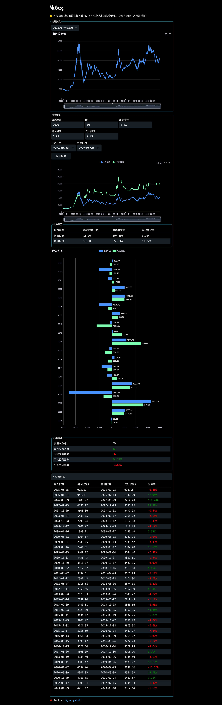

<p align="center">

</p>

<p align="center">
<i>Midas</i> is a free and open source <i>Moving Average Trading</i> backtest simulator
</p>

Bilibili Video: [https://www.bilibili.com/video/BV11o4y1B7fL](https://www.bilibili.com/video/BV11o4y1B7fL)

> [!CAUTION]
>
> Investment risks should be considered carefully when entering the market.
>
> This project does NOT provide investment advice to anyone.

## How to run

### 1. Run `midas-http`

```bash
cargo run --bin midas-http
```

### 2. Run `midas-web`

```bash
cd midas-web
bun install
bun run dev
```

### ?. Optional

You can update Index Data using `midas-spider`

```bash
cargo run --bin midas-spider
```


## 回测口径（v2）

`simulate` 现在支持更接近真实组合的参数，旧接口保持兼容：

- **双边成本**：买入费率、卖出费率分开；可再加单边滑点。
- **成交延迟**：`0` = 当日收盘成交，`1` = T 日收盘信号、T+1 收盘成交。
- **现金收益**：空仓现金按年化收益率逐日计息。
- **股息**：持仓期间按年化股息率逐日计提并按收盘价再投资，近似全收益指数。
- **波动率目标**：用 `stochastic-rs-stats` 的 EWMA（RiskMetrics λ=0.94）预测年化波动率，按 `目标波动率 / 预测波动率` 调整仓位；支持最大杠杆、融资成本和调仓阈值。
- **风险指标**：Sharpe、最大回撤、Calmar、平均仓位、交易次数、胜率、盈亏比、费用/股息/利息拆解。
- **策略模式**：
  - `classic`：经典 Midas，突破买入、从 N 日高点回撤卖出、全仓/空仓。
  - `strength`：强度仓位，突破越强仓位越高（`minWeight` 到 1），收盘跌破 MA 离场。
- **快速参数预设**：`MA30 / 买入 1.03 / 卖出 0.98`。在深证成指、创业板等指数上历史上优于 `1.05/0.95`，但在沪深300全历史上不一定；请用不同指数和区间验证。

日期区间只影响模拟区间，均线和滚动最高价仍使用区间之前的完整历史，避免区间开头没有暖机数据。


### 简单跟盘

简单模式默认只保留 4 个宽基指数（沪深300、上证50、创业板指、科创50），固定使用：

- 经典 MA30，买入阈值 `1.05`，卖出阈值 `0.95`
- 全仓/空仓，不做部分仓位、不加杠杆
- **周频**：每周五收盘后检查，信号变化时下一个交易日执行
- ETF 双边成本 + 滑点，现金收益/股息按年化估算
- 页面只展示：当前持有/空仓、策略信号、示例 ETF、金额、下次检查日、最近交易

示例 ETF 仅用于说明对应关系，不构成投资建议；请自行核对基金代码、规模、费率和跟踪误差。研究模式保留完整参数、成本、波动率目标和回测指标。

### 本地开发

```bash
cargo run --bin midas-http
cd midas-web && bun install && bun run dev
```

`midas-web/.env` 默认留空，开发时由 Vite 代理到 `127.0.0.1:8000`。

### 生产

```bash
cargo build --release
cd midas-web && bun run build
BIND_ADDR=127.0.0.1:8000 STATIC_DIR=midas-web/dist ./target/release/midas-http
```

前端由同一个进程托管，API 路径优先，其余回退到 `index.html`。

> 回测结果依赖数据区间、成本和现金/股息假设；不构成投资建议。

## Test

```bash
cargo test
```

## License

[GNU Affero General Public License v3.0](https://choosealicense.com/licenses/agpl-3.0)

## Screenshot


