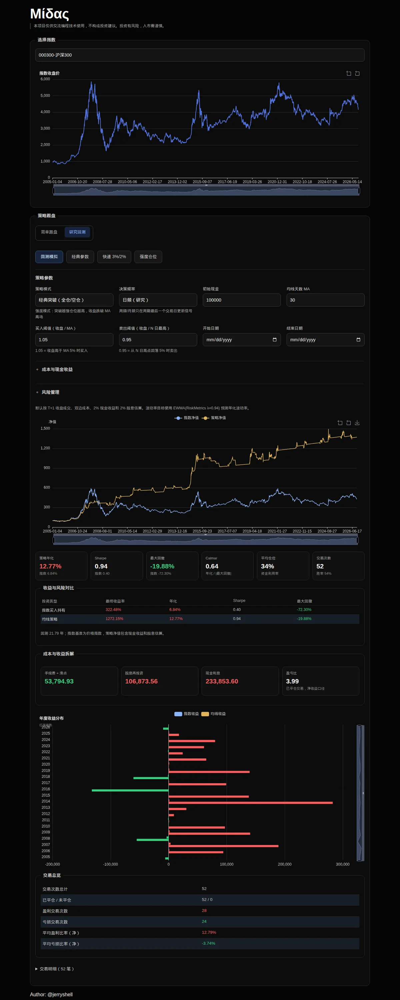

<p align="center">
  
</p>

<h1 align="center">Midas</h1>

<p align="center">国内指数基金 MA 策略回测与周频跟盘工具</p>

> [!CAUTION]
> 本项目仅供交流编程技术使用，不构成投资建议。投资有风险，入市需谨慎。



*研究回测：指数走势、策略净值、风险指标与年度收益。*

## 功能

### 简单跟盘

- 只保留 4 个宽基指数：沪深300、上证50、创业板指、科创50。
- 固定经典 MA30 / 买入 `1.05` / 卖出 `0.95`，不要求用户调参。
- **周频**：每周五收盘后检查，信号变化时下一个交易日执行。
- 页面只显示：当前持有/空仓、策略信号、下次检查日、最近交易。
- 信号按对应指数的日线收盘计算。
- 不启用部分仓位、杠杆、多基金轮动。

### 研究回测

- 策略模式：经典突破、强度仓位。
- 决策频率：日频、周频、月频。
- 双边费率、滑点、T+1 成交、现金收益、股息再投资。
- EWMA 波动率目标仓位（`stochastic-rs-stats`，RiskMetrics λ=0.94）。
- 指标：年化、Sharpe、最大回撤、Calmar、平均仓位、胜率、盈亏比、费用/股息/利息拆解。
- 日期区间只影响模拟区间，均线和滚动最高价仍使用区间前的完整历史。

### 回测口径

- 简单跟盘默认：双边 `2bp` + 单边滑点 `2bp`，现金年化 `2%`，股息年化 `2%`，T+1 收盘成交。
- 研究回测可单独调整买入/卖出费率、滑点、现金收益、股息、成交延迟、波动率目标、杠杆和调仓阈值。
- 指数数据是价格指数，股息为近似估算；实际基金收益还会受到管理费、托管费、跟踪误差和申赎费影响。

## 数据

- `index-data/`：8 个国内指数的日线收盘数据。
- `midas-spider`：从东方财富拉取；失败时自动切换腾讯接口，并与本地历史合并。
- 更新数据：

```bash
cargo run --bin midas-spider
```

- `midas-core/index-data/` 是单元测试使用的固定历史数据，不会被 spider 覆盖。

## 快速开始

### 开发

```bash
cargo run --bin midas-http
```

另开一个终端：

```bash
cd midas-web
bun install
bun run dev
```

`midas-web/.env` 默认留空，开发时由 Vite 代理到 `127.0.0.1:8000`。

### 生产

```bash
cargo build --release
cd midas-web && bun run build
BIND_ADDR=127.0.0.1:8000 \
STATIC_DIR=midas-web/dist \
./target/release/midas-http
```

前端由同一个进程托管：API 路由优先，其余回退到 `index.html`。

## 测试

```bash
cargo test
cd midas-web
bun run build
bun run typecheck
bun run lint
bun run fmt:check
```

## License

[GNU Affero General Public License v3.0](LICENSE)
